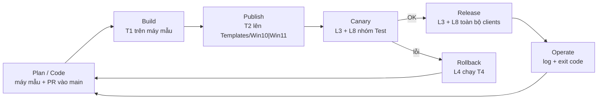
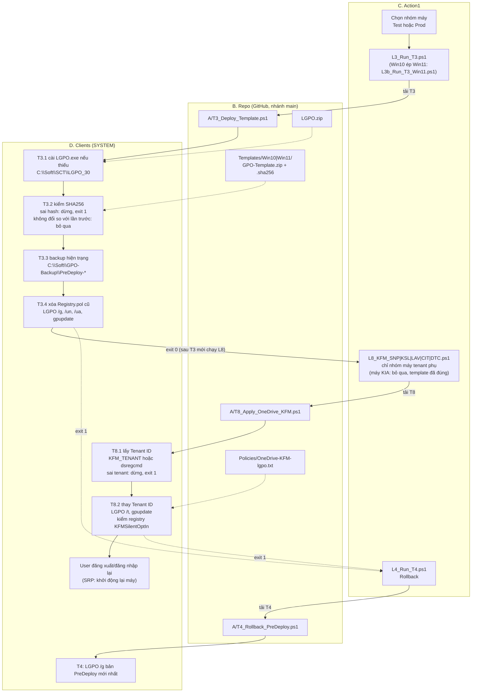

# Script Map: vòng đời phát triển và deploy LGPO template (kiểu CI/CD)

Bảng chi tiết từng script (cột `Repo | Action 1 | Usage | Note`): [`Script-Map.csv`](Script-Map.csv).
Hướng dẫn thao tác cho Helpdesk (cấu hình chung tự động và cấu hình đặc thù của từng công ty thành viên, tenant phụ): [`Helpdesk-Runbook.md`](Helpdesk-Runbook.md).

Bốn cột (lane) của quy trình:

| Cột | Vai trò | Tương đương DevOps |
|---|---|---|
| **A. Máy mẫu** | Laptop 655: cấu hình tay, test, đóng gói | Dev + Build agent |
| **B. Repo** | GitHub `JaxVN/LGPO`: script, file mẫu, ZIP template, LGPO.zip | Source control + Artifact registry |
| **C. Action1** | Điều phối: automation, nhóm máy (Test / Prod), nhận exit code | Release pipeline / orchestrator |
| **D. Clients** | Máy người dùng (Workgroup hoặc Entra ID joined), SYSTEM | Môi trường Staging / Production |

## 1. Vòng đời tổng quát (Build → Publish → Canary → Release)

## 2. Deploy cho Clients: cần những script nào

Áp dụng cho cả Canary và Release. Hình thể hiện từng cột: **C Action1** gọi launcher, launcher tải script từ **B Repo**, script chạy trên **D Clients**.

### Bảng script theo từng bước deploy

| Bước | Chạy ở | Script (Action1) | Script (Repo) | File / artifact dùng | Kết quả |
|---|---|---|---|---|---|
| 1. Deploy template | Clients | `A/L3_Run_T3.ps1` | `A/T3_Deploy_Template.ps1` | `LGPO.zip`, `Templates/<OS>/GPO-Template.zip` + `.sha256` | Local GPO giống máy mẫu, log `C:\Soft\GPO-Template\deploy.log` |
| 1b. Win10 dùng template Win11 | Clients | `A/L3b_Run_T3_Win11.ps1` | `A/T3_Deploy_Template.ps1` | như trên | ép `$OsFolder` |
| 2. KFM theo tenant | Clients | `A/L8_KFM_<TEN>.ps1` | `A/T8_Apply_OneDrive_KFM.ps1` | `Policies/OneDrive-KFM-lgpo.txt` | `KFMSilentOptIn` = Tenant ID đúng, log `C:\Soft\OneDrive-KFM\kfm.log` |
| 3. Rollback | Clients | `A/L4_Run_T4.ps1` | `A/T4_Rollback_PreDeploy.ps1` | `C:\Soft\GPO-Backup\PreDeploy-*` | khôi phục trạng thái trước T3 |

## Quy tắc quan trọng
- **T3 trước, L8 sau.** T3 xóa `Registry.pol` cũ nên mỗi lần T3 **thực sự deploy** (ZIP có SHA256 mới) thì phải chạy lại L8. Nếu T3 bỏ qua (ZIP không đổi) thì L8 giữ nguyên.
- Template mẫu hiện có `KFMSilentOptIn` = tenant KIA (`6fcf7bf2-...`). Máy của 5 tenant còn lại sẽ có giá trị này cho đến khi L8 ghi đè bằng đúng tenant của họ. Vì vậy **máy của KIA không cần chạy L8** (template đã đúng tenant). Chỉ **5 tenant phụ (SNP, KSL, LAV, CIT, DTC)** chạy `L8_KFM_<TEN>` cho đúng nhóm máy, sau khi deploy template cho toàn bộ clients.
- Mỗi lần đổi `Policies/*.txt` hoặc script là qua **PR vào `main`**, vì launcher và `.bat` đều tải từ `main`.
- **Luôn thử nhóm Test** (1-2 máy, gồm một máy Entra joined và một máy Workgroup) trước khi áp cho cả công ty.
- Template là artifact có SHA256 (`.sha256`): T3 từ chối ZIP sai hash.
