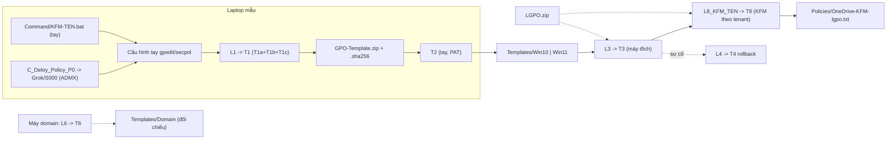

# Script Map

Bảng chi tiết: [`Script-Map.csv`](Script-Map.csv) (cột `Repo | Action 1 | Usage | Note`, mở bằng Excel).

Thứ tự trên máy đích: **T3 trước, L8 sau** (T3 xóa `Registry.pol` cũ nên sẽ xóa KFM nếu L8 chạy trước).
