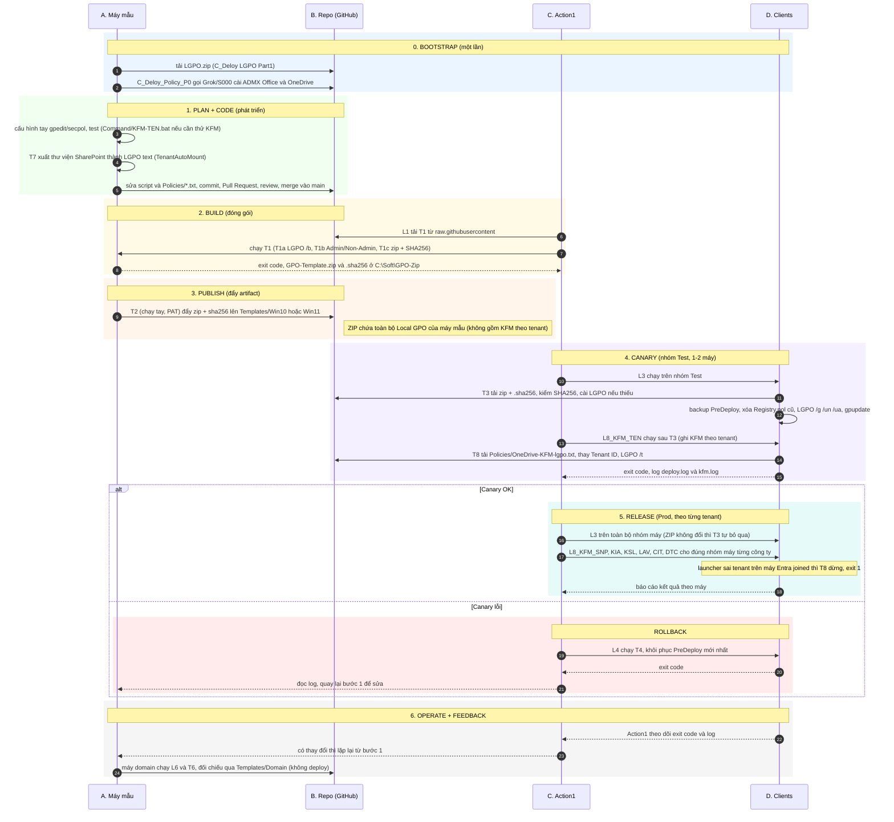
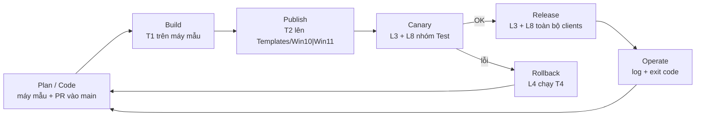

# Script Map: vòng đời phát triển và deploy LGPO template (kiểu CI/CD)

Bảng chi tiết từng script (cột `Repo | Action 1 | Usage | Note`): [`Script-Map.csv`](Script-Map.csv).

Bốn cột (lane) của quy trình:

| Cột | Vai trò | Tương đương DevOps |
|---|---|---|
| **A. Máy mẫu** | Laptop 655: cấu hình tay, test, đóng gói | Dev + Build agent |
| **B. Repo** | GitHub `JaxVN/LGPO`: script, file mẫu, ZIP template, LGPO.zip | Source control + Artifact registry |
| **C. Action1** | Điều phối: automation, nhóm máy (Test / Prod), nhận exit code | Release pipeline / orchestrator |
| **D. Clients** | Máy người dùng (Workgroup hoặc Entra ID joined), SYSTEM | Môi trường Staging / Production |

## Vòng đời

## Vòng lặp tóm tắt

## Quy tắc quan trọng
- **T3 trước, L8 sau**: T3 xóa `Registry.pol` cũ nên sẽ xóa KFM nếu L8 chạy trước.
- Mỗi lần đổi `Policies/*.txt` hoặc script là qua **PR vào `main`**, vì launcher và `.bat` đều tải từ `main`.
- **Luôn thử nhóm Test** (1-2 máy, gồm một máy Entra joined và một máy Workgroup) trước khi áp cho cả công ty.
- Template là artifact có SHA256 (`.sha256`): T3 từ chối ZIP sai hash.
