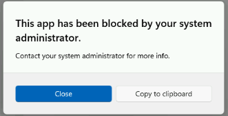
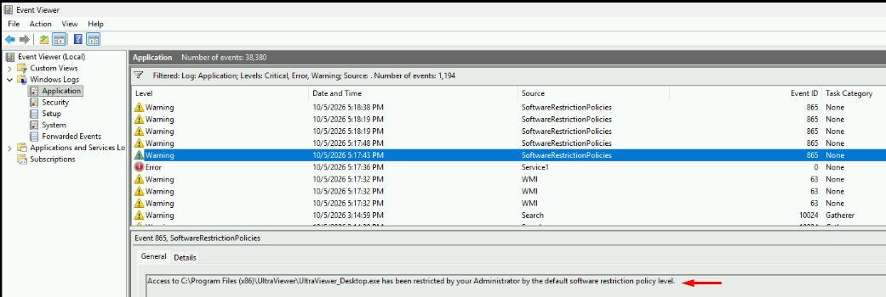

# Cập nhật cấu hình Local Group Policies

| | |
|---|---|
| **Đơn vị thực hiện** | Bộ phận CNTT |
| **Phạm vi áp dụng** | Máy tính người dùng nội bộ thuộc hệ thống công ty |
| **Trạng thái** | Bản trình phê duyệt (cập nhật từ bản nháp) |

## 1. Mục đích

Cập nhật cấu hình Local Policies, tách rõ phạm vi áp dụng theo hai nhánh:

- **User Configuration – Non-Administrators Policy**: kiểm soát việc lưu tài liệu Office vào vị trí cloud, chặn ghi dữ liệu ra thiết bị lưu trữ ngoại vi và áp dụng Software Restriction Policy (SRP).
- **Computer Configuration – All Users**: giới hạn tổ chức được phép đồng bộ OneDrive và bật báo cáo tình trạng đồng bộ trên máy công ty.

## 2. Phạm vi áp dụng

- Áp dụng cho máy tính Windows do công ty quản lý.
- Ưu tiên triển khai cho máy tính đang kết nối vào hệ thống mạng nội bộ.
- Không áp dụng cho máy chủ, thiết bị chuyên dụng hoặc máy tính có yêu cầu cấu hình riêng nếu chưa được phê duyệt.

## 3. Nội dung cấu hình đề xuất

### 3.1. Danh sách chính sách cần cập nhật

Cách đọc: mỗi bảng là một nhánh cấu hình; dòng **in đậm** là đường dẫn trong Group Policy Editor, các dòng bên dưới là chính sách nằm trong đường dẫn đó (cùng cách trình bày với tài liệu hướng dẫn của ACSC/ASD).

#### A. Computer Configuration – All Users

| Chính sách | Trạng thái | Giá trị | Tác dụng |
|---|---|---|---|
| **Computer Configuration\Administrative Templates\OneDrive** | | | |
| Allow syncing OneDrive accounts for only specific organizations | Enabled | Danh sách Tenant ID (mục 3.2) | Chỉ cho phép đồng bộ tài khoản OneDrive thuộc các tổ chức có Tenant ID được khai báo; ngăn người dùng thêm hoặc đồng bộ OneDrive từ tổ chức không được phép. |
| Enable sync health reporting for OneDrive | Enabled | – | Bật báo cáo tình trạng đồng bộ OneDrive để thiết bị gửi dữ liệu sức khỏe đồng bộ về dashboard quản trị; hỗ trợ nhận diện, điều tra và xử lý lỗi đồng bộ. |

#### B. User Configuration – Non-Administrators Policy

| Chính sách | Trạng thái | Giá trị | Tác dụng |
|---|---|---|---|
| **User Configuration\Administrative Templates\Microsoft Office 2016\Miscellaneous** | | | |
| Restrict saving on non-Cloud locations | Enabled | 133 | Hạn chế người dùng không thuộc nhóm quản trị lưu tài liệu Office vào vị trí không thuộc cloud; định hướng lưu Word, Excel, PowerPoint lên môi trường cloud do công ty quản lý. |
| **User Configuration\Administrative Templates\System\Removable Storage Access** | | | |
| Removable Disks: Deny write access | Enabled | – | Chặn ghi dữ liệu vào USB hoặc ổ đĩa rời, giảm rủi ro sao chép dữ liệu công ty ra thiết bị ngoại vi. |
| CD and DVD: Deny write access | Enabled | – | Chặn ghi dữ liệu ra đĩa CD/DVD. |
| Tape Drives: Deny write access | Enabled | – | Chặn ghi dữ liệu vào thiết bị băng từ, nếu có kết nối với máy client. |
| WPD Devices: Deny write access | Enabled | – | Chặn ghi dữ liệu vào điện thoại, máy nghe nhạc, máy ảnh hoặc thiết bị Windows Portable Devices khác. |

> **Ghi chú:** *Restrict saving on non-Cloud locations* và các chính sách *Deny write access* đặt tại nhánh **User Configuration – Non-Administrators Policy** (chỉ áp cho người dùng không phải quản trị). Các chính sách OneDrive đặt tại nhánh **Computer Configuration – All Users** để có hiệu lực chung trên máy client. Đường dẫn đầy đủ trong `gpedit.msc` bắt đầu bằng `Local Computer\` (nhánh Computer) hoặc `Local Computer\Non-Administrators Policy\` (nhánh Non-Administrators).

### 3.2. Tenant ID được phép đồng bộ OneDrive

| STT | Công ty | Tenant ID |
|---|---|---|
| 1 | DTC | `02cc35ba-57a1-438b-8ae4-f68de204fe24` |
| 2 | CIT | `e9e8ce93-6c8e-48c7-81ec-20fc1841b63c` |
| 3 | LAV | `fa0fc2b5-6ddc-40aa-8f77-838d08c1e9e7` |
| 4 | KSL | `692eb525-c279-4d74-a010-638ac401a7d9` |
| 5 | KIA (công ty chính) | `6fcf7bf2-2eb6-4b21-b92a-914d27ce33a8` |
| 6 | SNP | `4be02620-368a-4c1c-81da-d298040b2d92` |

> **Lưu ý:** Khi cấu hình chính sách OneDrive tại nhánh Computer Configuration, cần nhập đầy đủ các Tenant ID trên trong mục **Show…** của chính sách. Giá trị trên lấy từ file cấu hình `Policies/OneDrive-Machine-lgpo.txt`.

### 3.3. Software Restriction Policy (SRP)

**Giai đoạn 2.** Danh sách Path Rule SRP đã gộp từ 11 GPO.

**Mục tiêu:** cho phép các ứng dụng, thư mục và đường dẫn nghiệp vụ cần thiết được chạy; chặn Microsoft Store theo đường dẫn WindowsApps; bổ sung hash rule để cho phép `vfp7.exe` chạy bất kể đường dẫn ổ mạng.

#### A. Cho phép chạy (Unrestricted) – 51 path

| STT | Path Rule | Ghi chú |
|---|---|---|
| 1 | `%AppData%\Telegram Desktop` | Telegram Desktop |
| 2 | `%HKEY_LOCAL_MACHINE\SOFTWARE\Microsoft\Windows NT\CurrentVersion\SystemRoot%` | Đường dẫn hệ thống Windows |
| 3 | `%HKEY_LOCAL_MACHINE\SOFTWARE\Microsoft\Windows\CurrentVersion\Authentication%` | Thành phần xác thực Windows |
| 4 | `%HKEY_LOCAL_MACHINE\SOFTWARE\Microsoft\Windows\CurrentVersion\ProgramFilesDir (x86)%` | Program Files x86 |
| 5 | `%HKEY_LOCAL_MACHINE\SOFTWARE\Microsoft\Windows\CurrentVersion\ProgramFilesDir%` | Program Files |
| 6 | `%LOCALAPPDATA%\Temp\is-*.tmp\iTaxViewer*.tmp` | iTaxViewer khi cài đặt/cập nhật |
| 7 | `%LocalAppData%\Viber` | Viber |
| 8 | `%UserProfile%\Desktop` | Chạy từ Desktop người dùng |
| 9 | `*.lnk` | Shortcut |
| 10 | `\\%USERDNSDOMAIN%\Sysvol\` | Sysvol domain |
| 11 | `\\10.10.6.13\FASTFOXPRO\*` | FAST FoxPro |
| 12 | `\\kiena.local\dfs\Public\IT\00. Software\03. Deloy\*` | Nguồn triển khai phần mềm IT |
| 13 | `\\kiena.local\NETLOGON\LAPS\` | LAPS |
| 14 | `\\stcvm003\FASTFOXPRO\*` | FAST FoxPro |
| 15 | `\\stcvm003\FASTFOXPRO\KIENTHINH` | FAST FoxPro |
| 16 | `\\stcvm003\FASTFOXPRO\KIENTHINH\KIENTHINH` | FAST FoxPro |
| 17 | `\\stcvm003\FASTFOXPRO\KIENTHINH\KIENTHINH_2015` | FAST FoxPro |
| 18 | `\\stcvm003\FASTFOXPRO\KIENTHINH\KIENTHINH_2015\WS` | FAST FoxPro |
| 19 | `C:\Dev\*` | Thư mục Dev |
| 20 | `C:\FAST\*` | FAST |
| 21 | `C:\Program Files (x86)\iTax Viewer\iTaxViewer.exe` | iTaxViewer |
| 22 | `C:\Program Files\Adobe\Acrobat DC\Acrobat\Acrobat.exe` | Adobe Acrobat |
| 23 | `C:\Soft\*` | Thư mục Soft |
| 24 | `C:\Users\*\AppData\Local\CapCut\Apps\CapCut.exe` | CapCut |
| 25 | `C:\Users\*\AppData\Local\Microsoft\*` | Microsoft Local AppData |
| 26 | `C:\Users\*\AppData\Local\Microsoft\*.exe` | Microsoft Local AppData |
| 27 | `C:\Users\*\AppData\Local\Microsoft\*\*.exe` | Microsoft Local AppData |
| 28 | `C:\Users\*\AppData\Local\Microsoft\*\*\*.exe` | Microsoft Local AppData |
| 29 | `C:\Users\*\Appdata\Local\Microsoft\Onedrive\??.?.????.????\*.exe` | OneDrive client |
| 30 | `C:\Users\*\AppData\Local\SquirrelTemp\Update.exe` | MS Teams |
| 31 | `C:\Users\*\AppData\Local\Temp\__PSScriptPolicyTest_wyfozhqi.hlr.psm1` | PowerShell policy test |
| 32 | `C:\Users\*\AppData\Local\Temp\__PSScriptPolicyTest_yveoahug.qle.ps1` | PowerShell policy test |
| 33 | `C:\Users\*\AppData\Local\Viber\Viber.exe` | Viber |
| 34 | `C:\Users\*\AppData\Roaming\Autodesk\ADPSDK\bin\ADPClientService.exe` | Autodesk ADP |
| 35 | `C:\Users\*\AppData\Roaming\Autodesk\ADPSDK\bin\AdpSDKUtil.exe` | Autodesk ADP |
| 36 | `C:\Users\*\AppData\Roaming\D5 Render\d5_immerse\Binaries\Win64\d5_immerse.exe` | D5 Render |
| 37 | `C:\Users\*\AppData\Roaming\D5 Render\d5_launcher.exe` | D5 Render |
| 38 | `C:\Users\*\AppData\Roaming\D5 Render\d5_render.exe` | D5 Render |
| 39 | `C:\Users\ngan.hong\AppData\Local\PCHealthCheck\PCHealthCheck.exe` | PC Health Check |
| 40 | `C:\WINDOWS\system32\backgroundTaskHost.exe` | Windows system process |
| 41 | `C:\Windows\System32\BackgroundTransferHost.exe` | Windows system process |
| 42 | `C:\Windows\System32\SecurityHealth\*\SecurityHealthHost.exe` | Windows Security Health |
| 43 | `D:\FAST\*` | FAST |
| 44 | `F:\*\*\*\*` | FAST FoxPro |
| 45 | `F:\*\vfp7.exe` | Visual FoxPro |
| 46 | `F:\*\WS\vfp7.exe` | Visual FoxPro |
| 47 | `F:\KIENA\2025\kiena_2015-2018\WS\vfp7.exe` | Visual FoxPro |
| 48 | `F:\KIENTHINH` | KIENTHINH |
| 49 | `F:\KIENTHINH\KIENTHINH\WS\` | KIENTHINH |
| 50 | `F:\KIENTHINH\KIENTHINH\WS\vfp7.exe` | Visual FoxPro |
| 51 | `F:\KIENTHINH\KIENTHINH_2015\WS\` | KIENTHINH |

#### B. Chặn chạy (Disallowed) – 1 path

| STT | Path Rule | Ghi chú |
|---|---|---|
| 1 | `%programfiles%\WindowsApps\Microsoft.WindowsStore*` | Tắt MS Store, người dùng không tự cài ứng dụng từ MS Store |

#### C. Hash Rule – 1 rule (cập nhật so với bản nháp: trước đây ghi "Không dùng")

| STT | Tệp | Phiên bản | Kích thước | Thuật toán | Giá trị hash |
|---|---|---|---|---|---|
| 1 | `vfp7.exe` | Visual FoxPro 7.0.0.9262 | 4.354.048 byte | MD5 + SHA256 | MD5 `3f57c7f31da4a8faca414fe01b12e10e`<br>SHA256 `716d55c3f52e5eda3b4afec0d7fa8fd41383e22513a9ff752cc10084957571e8` |

**Lý do bổ sung:** trên máy kế toán, `vfp7.exe` bị chặn (Event 865) khi chạy từ `F:\WS\vfp7.exe`, đường dẫn không khớp path rule nào dù đã có các rule `F:\KIENTHINH\...`. Trước đây hash rule phải tạo tay trên từng máy client. Nay hash rule nằm sẵn trong file cấu hình `Policies/SRP-NonAdmin-lgpo.txt` (GUID `{133d0536-7da9-401b-94f2-8d2e20136031}`), nạp bằng LGPO cùng các path rule, **không cần tạo tay trên máy client**.

**Lưu ý vận hành hash rule:**

- Hash gắn với nội dung tệp. Khi FAST hoặc FoxPro cập nhật `.exe`, hoặc máy dùng bản `vfp7.exe` khác, cần thêm hash rule mới.
- Giá trị nhị phân trong file LGPO viết dạng byte hex ngăn cách bằng dấu phẩy (`BINARY:3f,57,c7,...`). Viết liền sẽ bị ghi sai thành 1 byte và rule không có tác dụng.

## 4. Yêu cầu chuẩn bị trước triển khai

Trước khi cập nhật các chính sách nêu trên, cần chạy script Action1 `C_Deloy_Policy_P0` để tải bộ Administrative Templates `.admx` của Microsoft Office và OneDrive về các máy client. Đây là bước bắt buộc để bảo đảm máy client có đủ mẫu chính sách cần thiết trước khi cấu hình Office và OneDrive trong hai nhánh *User Configuration – Non-Administrators Policy* và *Computer Configuration – All Users*.

## 5. Nguyên tắc triển khai

> Chỉ thực hiện cập nhật Local Policies **sau khi** hoàn tất bước chạy script Action1 `C_Deloy_Policy_P0` và xác nhận bộ `.admx` của Office, OneDrive đã được tải về đúng vị trí trên máy client.

1. Chạy script Action1 `C_Deloy_Policy_P0` trước khi cấu hình chính sách.
2. Kiểm tra máy client đã có đủ bộ `.admx` của Microsoft Office và OneDrive.
3. Rà soát cấu hình hiện tại ở hai nhánh *User Configuration – Non-Administrators Policy* và *Computer Configuration – All Users*.
4. Cấu hình *Restrict saving on non-Cloud locations* tại nhánh User Configuration – Non-Administrators Policy.
5. Cấu hình các chính sách *Deny write access* cho thiết bị lưu trữ ngoại vi tại nhánh User Configuration – Non-Administrators Policy.
6. Cấu hình các chính sách OneDrive tại nhánh Computer Configuration – All Users, gồm *Allow syncing OneDrive accounts for only specific organizations* và *Enable sync health reporting for OneDrive*.
7. Cấu hình SRP theo danh sách đã gộp từ 11 GPO (Unrestricted, Disallowed, Hash Rule). Nạp bằng LGPO từ file cấu hình trong repo, không tạo tay từng máy:
   ```cmd
   curl.exe -sSL "https://raw.githubusercontent.com/JaxVN/LGPO/main/Policies/SRP-NonAdmin-lgpo.txt?t=%RANDOM%" -o C:\Soft\SCT\SRP-NonAdmin-lgpo.txt
   C:\Soft\SCT\LGPO_30\LGPO.exe /t C:\Soft\SCT\SRP-NonAdmin-lgpo.txt
   gpupdate /force
   ```
   Sau đó người dùng đăng xuất và đăng nhập lại (lần đầu áp SRP nên khởi động lại máy).
8. Thử nghiệm trên nhóm máy mẫu trước khi triển khai diện rộng.
9. Ghi nhận kết quả triển khai, danh sách máy thành công, danh sách máy lỗi và hướng xử lý.

## 6. Kế hoạch thực hiện dự kiến

| Giai đoạn | Nội dung | Thời gian dự kiến | Người thực hiện |
|---|---|---|---|
| 1 | Chạy `C_Deloy_Policy_P0`, kiểm tra `.admx` | *(điền)* | *(điền)* |
| 2 | Cấu hình policy trên máy mẫu, kiểm tra SRP và hash rule | *(điền)* | *(điền)* |
| 3 | Thử nghiệm trên nhóm máy mẫu (kế toán, văn phòng) | *(điền)* | *(điền)* |
| 4 | Triển khai diện rộng, ghi nhận kết quả | *(điền)* | *(điền)* |

## 7. Tiêu chí nghiệm thu

- Script Action1 `C_Deloy_Policy_P0` đã chạy thành công trên các máy thuộc phạm vi triển khai.
- Bộ `.admx` của Microsoft Office và OneDrive đã được tải về đầy đủ trên máy client.
- *Restrict saving on non-Cloud locations* được cấu hình đúng tại User Configuration – Non-Administrators Policy và ở trạng thái Enabled.
- Các chính sách chặn ghi thiết bị lưu trữ ngoại vi được cấu hình đúng tại User Configuration – Non-Administrators Policy và ở trạng thái Enabled.
- *Allow syncing OneDrive accounts for only specific organizations* và *Enable sync health reporting for OneDrive* được cấu hình đúng tại Computer Configuration – All Users và ở trạng thái Enabled.
- SRP được cấu hình đúng danh sách: 51 path Unrestricted, 1 path Disallowed và 1 Hash Rule (`vfp7.exe`) nạp sẵn bằng file cấu hình LGPO. Hash rule hiện trong registry người dùng thường tại `HKCU\Software\Policies\Microsoft\Windows\Safer\CodeIdentifiers\262144\Hashes` với `ItemData` đủ 16 byte (MD5) và 32 byte (SHA256).
- `vfp7.exe` chạy được bằng tài khoản không phải admin, không còn Event 865 báo `vfp7.exe`.
- Người dùng Office được định hướng lưu tài liệu mới vào vị trí cloud theo chính sách đã cấu hình.
- OneDrive chỉ cho phép đồng bộ tài khoản thuộc các Tenant ID đã khai báo.
- Báo cáo tình trạng đồng bộ OneDrive được bật để hỗ trợ theo dõi sức khỏe đồng bộ trên các máy client.
- Có danh sách máy đã kiểm tra, máy thành công, máy lỗi và hướng xử lý tương ứng.

## 8. Rủi ro và phương án xử lý

| Rủi ro | Ảnh hưởng | Phương án xử lý |
|---|---|---|
| Script `C_Deloy_Policy_P0` không chạy thành công trên một số máy client. | Máy client thiếu bộ `.admx` nên không thể cấu hình hoặc kiểm tra đủ chính sách Office và OneDrive. | Kiểm tra trạng thái chạy script, chạy lại trên máy lỗi và lập danh sách máy chưa hoàn tất. |
| Bộ `.admx` của Office hoặc OneDrive tải về chưa đầy đủ. | Không hiển thị đủ đường dẫn hoặc thiết lập chính sách cần cập nhật. | Xác nhận lại nguồn tải, vị trí lưu file và đối chiếu danh sách file cần có trước khi cấu hình. |
| *Restrict saving on non-Cloud locations* cấu hình sai nhánh. | Chính sách áp dụng không đúng đối tượng hoặc ảnh hưởng ngoài phạm vi mong muốn. | Chỉ cấu hình tại nhánh User Configuration – Non-Administrators Policy theo phạm vi đã xác định. |
| Chính sách chặn ghi thiết bị lưu trữ ngoại vi cấu hình sai nhánh hoặc thiếu chính sách. | Người dùng vẫn có thể ghi dữ liệu ra USB, CD/DVD, thiết bị WPD hoặc thiết bị lưu trữ khác. | Đối chiếu lại nhánh Non-Administrators Policy, bảo đảm các chính sách *Deny write access* đều ở trạng thái Enabled. |
| Thiếu Path Rule hoặc cấu hình sai SRP. | Ứng dụng nghiệp vụ có thể không chạy được, hoặc ứng dụng không mong muốn vẫn chạy được. | Đối chiếu lại danh sách SRP đã gộp từ 11 GPO, kiểm tra riêng nhóm Unrestricted, Disallowed và Hash Rule trên máy mẫu trước khi triển khai diện rộng. |
| Hash rule sai định dạng hoặc lỗi thời khi FoxPro/FAST cập nhật `.exe`. | `vfp7.exe` bị chặn dù đã có hash rule. | Kiểm tra `ItemData` bằng `reg query` (16/32 byte); khi có bản `.exe` mới, lấy hash mới từ máy mẫu (T6) và thêm vào file cấu hình. |
| Thiếu hoặc nhập sai Tenant ID trong chính sách OneDrive. | Người dùng có thể không đồng bộ được OneDrive công ty hoặc vẫn đồng bộ được tổ chức không mong muốn. | Đối chiếu lại danh sách Tenant ID trước khi áp dụng và kiểm tra thực tế trên máy mẫu. |
| *Enable sync health reporting for OneDrive* chưa được bật trên máy client. | Thiết bị không gửi dữ liệu tình trạng đồng bộ về dashboard quản trị, khó theo dõi và xử lý lỗi. | Kiểm tra nhánh Computer Configuration – All Users, bảo đảm chính sách Enabled và áp dụng lại trên máy mẫu. |
| Chính sách hạn chế lưu ngoài cloud làm thay đổi thói quen lưu file. | Người dùng khó khăn khi lưu file vào vị trí cục bộ như Desktop hoặc Documents. | Thông báo trước, hướng dẫn người dùng lưu tài liệu vào vị trí cloud do công ty quản lý. |

## 9. Giải quyết sự cố SRP

Khi người dùng mở ứng dụng mà bị chặn, thường sẽ có bảng thông báo:



IT kiểm tra log qua Event Viewer (Windows Logs → Application, nguồn `SoftwareRestrictionPolicies`, Event ID 865). Dòng `AttemptedPath` là chương trình bị chặn:



Lấy nhanh 20 sự kiện mới nhất bằng CMD:

```cmd
wevtutil qe Application "/q:*[System[Provider[@Name='Microsoft-Windows-SoftwareRestrictionPolicies']]]" /c:20 /f:text /rd:true
```

Cách xử lý: thêm path rule `Unrestricted` cho đường dẫn bị chặn (hoặc hash rule nếu đường dẫn thay đổi theo máy) vào `Policies/SRP-NonAdmin-lgpo.txt`, nạp lại bằng LGPO như mục 5, bước 7.

## 10. Phê duyệt

| Vai trò | Họ và tên | Ý kiến | Ngày |
|---|---|---|---|
| Người lập | | | …/…/… |
| Người rà soát | | | …/…/… |
| Người phê duyệt | | | …/…/… |
